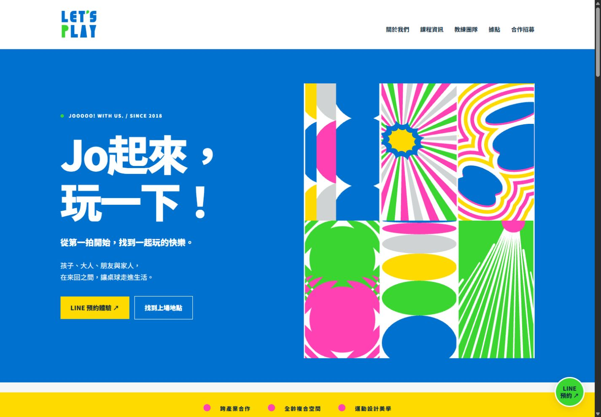

# 品牌 PDF 主題候選 0.3.0 驗證

已發布[獨立品牌預覽](https://d344e4ab.playtt-brand-preview.pages.dev/)，[部署與遠端驗證](DEPLOYMENT.md)記錄49個預覽檔精確、46個正式檔維持原內容。

2026-11-25，使用指定31頁品牌 PDF 的原始向量字標及六個聲音圖案，改為可編輯「Jo起來，玩一下！」首頁、響應式圖案排列與共用品牌色。內容更新含兩據點、兩組電話、移除王泳程、五位新增教練姓名及課程流程。來源與取捨見[品牌說明](../../brand/README.md)、[內容查核](../../CONTENT_REVIEW_20261125.md)。

## 已完成

- 主題 ZIP：42檔、898,004 bytes，SHA-256 `6062d72755b0ef0fe46e2e2bcaf2ee277f30abc3529ecbd3a1bcf8488a116e30`。原生安裝後42檔與來源逐一一致，見 [package.json](package.json)。PDF不包入主題或公開網站。
- WordPress 7.1.4／PHP 8.3／Playground SQLite 的隔離實例完成既有9項整合檢查：安裝啟用、6頁14媒體、匯入不覆寫已編輯內容、未授權匯入拒絕、修訂還原、私人草稿匿名不可見、媒體雜湊、重啟保存與獨立備份還原。見 [integration.json](integration.json)。
- 匿名匯出6頁與404、40個資產；成功結果見 [export.json](export.json)。第一次受限程序失敗沒有取得可判定原因的輸出，原始日誌及失敗暫存保留在本機；第二次以新實例完成。
- 實際 Chrome 檢查6頁 × 375／768／1440px共18組：無水平溢出、頁尾未被浮動LINE遮住、單一h1/main、繁中語系、圖片alt；已載入圖片未見壞圖。延後載入圖片不宣稱全數已載入。見 [responsive.json](responsive.json)。
- 手機選單鍵盤循環、Escape返回可見開啟按鈕；20個Tab焦點位置均可見且不被LINE擋住。手機選單項目至少60.75px高。見 [interaction.json](interaction.json)。
- 18次頁面導覽取得的 console warn/error 為空；這項觀測不涵蓋所有之後互動。四組色彩對比計算保存在 package.json，不代表完整WCAG驗收。




封裝前將 `style.css` 與 `theme.json` 的 CRLF 正規化為 repo 的 LF；兩檔除換行外完全相同，並以最終ZIP再次完成9項隔離整合檢查及42檔安裝比對。先前ZIP／整合結果保留為 `*-before-lf.json`。瀏覽器畫面與焦點結果來自相同內容的前一封裝；發布副本僅正規化CSS換行，其他50個檔案逐一不變，見 [export-normalized.json](export-normalized.json)。最終ZIP檔名為 `lets-play-0.3.0-source-lf.zip`。

## 重建

由 repo 的 `wordpress/` 執行，Python需要 PyMuPDF 1.28.0；Node及npm版本依package-lock與README。

```sh
python -X utf8 scripts/extract-brand-assets.py
node scripts/build-patterns.mjs
python -X utf8 scripts/package-theme.py /absolute/new-output.zip
node scripts/verify.mjs /absolute/fresh-wordpress-directory /absolute/new-output.zip
node scripts/export.mjs
```

打包工具預設拒絕覆寫既有ZIP。整合測試使用新的隔離目錄，不使用私人雲端WordPress資料。瀏覽器驗證針對本次新匯出的HTML，不是把舊站只換CSS後當作完整結果。

## 部署與限制

2026-11-25 已從登入的 Cloudflare Dashboard 讀回：Pages專案為 `playtt-brand-preview`，production branch是 `codex/playtt-wordpress-cloudflare`，自動部署啟用；所有非production分支可自動建立preview。root為 `cloudflare`，build為 `node verify-static.mjs`，output為 `public`，`SKIP_DEPENDENCY_INSTALL=1`。查核沒有修改設定。

因此來源分支 `codex/playtt-wordpress-cloudflare` 只交付主題來源與證據，`cloudflare/public` 保持原版本。0.3.0靜態輸出另由 `codex/playtt-brand-manual-preview` 分支發布，不能把此預覽視為正式網域切換。實際預覽部署與遠端雜湊驗證見[部署紀錄](DEPLOYMENT.md)。

主題更新不會自動覆寫已編輯的WordPress頁面。既有站套用新版首頁內容前須備份並明確選擇要更新的頁面。實體手機／IME／螢幕閱讀器、完整內容驗收、私人Cloudflare後台與長期免費限制仍待；本輪不宣稱完成全部目標。
