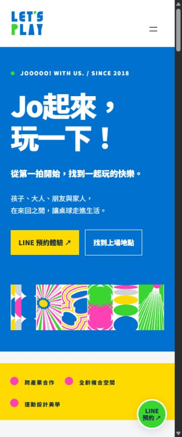

# 五頁內容與共用組件的原生編輯驗證

2026-11-25，主題來源 `172469989dfeafa2f58c8f95db89e83c0c35abca`，版本 0.3.1。使用隔離的本機 WordPress Playground、PHP 8.3、SQLite 與 Chrome 原生畫布。沒有 Supabase、Cloudflare 私人資料或正式官網寫入。

## 結果

- 品牌、課程、教練、據點、合作五頁：修改介紹文字、儲存、重載、恢復原文、再次儲存及重載，均成功，未見無效區塊。
- 品牌頁首：改「課程資訊」為測試文字，六頁的導覽文字及 `/class/` 連結核對通過，之後還原。
- 品牌頁尾：修改品牌說明，六頁均呈現新文字，之後還原。兩個組件均透過網站編輯器保存，未直接修改資料庫。
- 六頁 × 375／768／1440px 共 18 組 Chrome 視窗檢查：實際寬度一致、無水平溢出、各有一個 H1 與 main；已載入圖片無壞圖，裝飾圖片保留空 alt。未載入的 lazy 圖片不當作已成功下載。
- 登出後六頁不含管理列或測試文字，頁首頁尾恢復原文。獨立唯讀 SQLite 稽核確認 session 0、integrity_check 通過；八個既有頁面標題、slug、狀態與內容語意均恢復。

原生保存會改寫換行、class 空白、預設 H2 註解及實體編碼，五個經編輯頁面的原始位元不再相同；稽核比對 HTML／區塊語意。測試留下正常修訂、兩個導覽選單與兩個範本組件記錄，沒有宣稱資料庫完全未變。

## 限制與重現

核心封存檔是 WordPress 7.1.4，結束時 `version.php` 是 7.1.5。測試工具未逐步記錄核心版本，故不能稱為固定單一核心版本的驗收。這與前輪固定 Cloudflare runtime 的[安裝、首頁編輯與完整重啟試驗](README.md)是不同環境。

依[編輯手冊](../../EDITOR_GUIDE.md)操作五頁與兩個共用組件，每次保存後重載及檢查六頁前台，再還原原文、登出並關閉隔離服務即可重現操作路徑。所有本輪程序已退出；私人 owner、帳密與資料庫保留在 repo 外。

本輪瀏覽器 error 0，仍有一類 WordPress iframe 樣式載入警告。18 組尺寸是視窗模擬，未驗收實體手機、螢幕閱讀器或中文 IME。另在桌機與 375px 本機首頁延遲 SVG 回應 1,200ms，兩次 CLS 皆 0；此測試沒有 CPU／網路節流，不能當作訪客效能成績。

- [獨立內容與登出稽核](native-editor.json)
- [共用組件逐頁發布與還原](shared-parts.json)
- [18 組尺寸紀錄](native-responsive.json)
- [SVG 延遲實驗](svg-layout.json)

