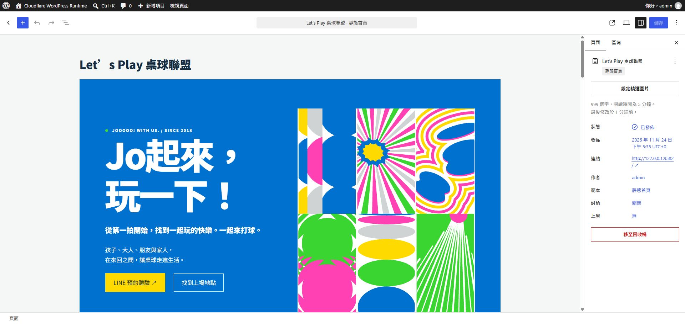
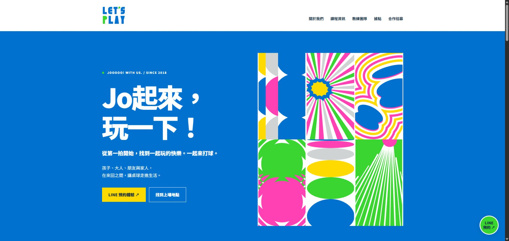

# 主題 0.3.1 原生編輯驗證

後續補齊[五個內容頁、共用頁首頁尾與18組版面驗證](NATIVE_EDITOR.md)，並交付[編輯手冊](../../EDITOR_GUIDE.md)。最新對比與地圖標籤修正版為[0.3.2](../theme-0.3.2/README.md)，本頁保留0.3.1原始測試。

0.3.0 的 SVG 圖片區塊在原生編輯器出現無效內容；0.3.1 修正產生格式，保留原始圖形、CSS、文字及前台設計。最新版42檔主題 ZIP SHA-256：`af64c988eca9213b81090bfde24585fe082b315ea2eff9ca9381fd3e29a69f06`。

固定 `2e9819b0` 本機 workerd 完成原生安裝啟用、六頁匯入、閱讀設定、Chrome 畫布修改保存、完整服務停止／重啟、新分頁讀回與登出。獨立備份確認重啟內容逐位元一致，其他頁面與媒體、42個主題檔、77個語言檔保留；所有測試 session 移除，服務及窗口已關閉。

成功輪：LOCAL27／310物件／298檔，13,010,228bytes／108puts，本機資料。沒有新雲端寫入或部署；不是免費 Cloudflare 後台驗收。[完整流程、前置失敗、console 限制與重建](../../../experiments/cloudflare-wordpress/brand-editor/README.md)。

前台 [0.3.0 品牌預覽](https://d344e4ab.playtt-brand-preview.pages.dev/) 仍可審閱視覺；這次沒有重發靜態輸出，正式官網維持既有內容。

上圖的「一起來打球。」是隔離副本的保存驗證文字，沒有加入交付主題或公開預覽。

