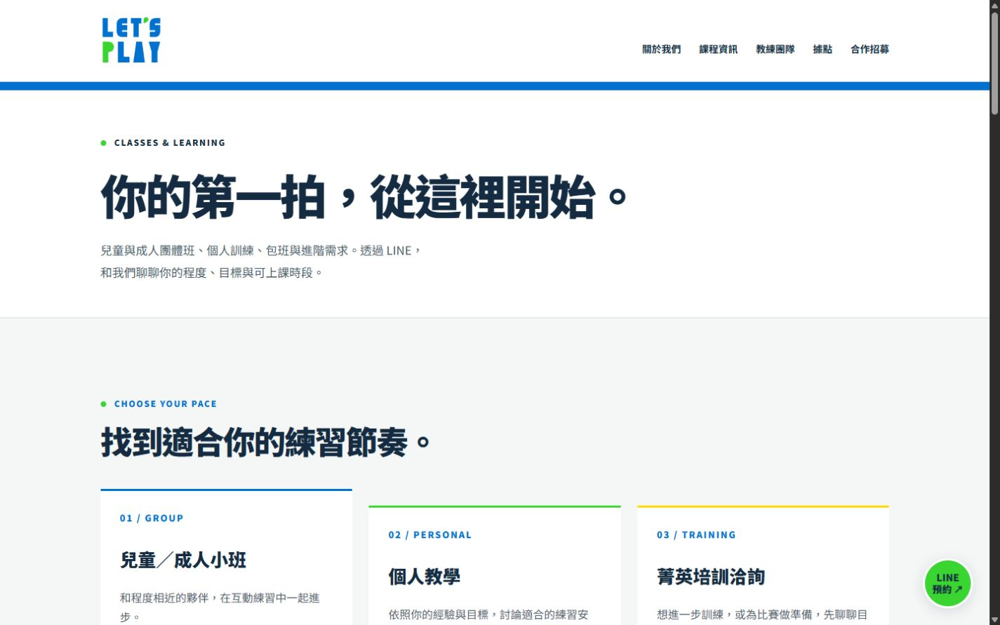
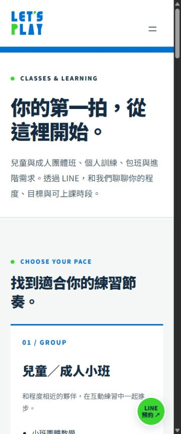
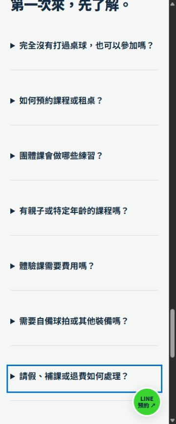

# 0.3.3 課程與營業內容整理

[公開預覽](https://1bb1c274.playtt-brand-preview.pages.dev/class/)已發布，deployment1bb1c274-c2dd-4aa4-ac47-40ed0e216bc7，Preview分支commit50c9bbc02515bce64a080fa0729d2efc0d5ea25a，來源4bb8d0254b4bc01fad96bc9d6950ae06e937bc9c。[遠端49檔](preview-http.json)／[正式46檔原樣](production-http.json)／[遠端QA與SEO讀回](preview-browser.json)均通過；404與301相符。

2026-11-25，對照[內容查核](../../CONTENT_REVIEW_20261125.md)發現0.3.2候選仍顯示舊價目、未核定L1–L12及客服時間，並把待確認是否相同的菁英／選手班合併。0.3.3保留歷史內容於內部文件，候選頁面改為洽詢現行安排。

- 六個入口：兒童／成人小班、個人教學、菁英培訓洽詢、租桌、營隊及包班。
- 課程流程保留資料庫已有的暖身、球感、動作練習與互動挑戰；新增學習安排與檢定洽詢，不編造學期課綱、測驗級數或通過標準。
- 七題QA涵蓋初學、預約、教學內容、親子／不同年齡需求、體驗費用、球具及請假補課退費。未確認的規則引導報名前洽詢，沒有宣稱特殊班型已開或體驗免費。
- 新匯入課程頁標題及description同步更新。正式Pages內容與私人後台維持現況。

## 驗證

本輪使用專案附帶Node24.18.0。匿名WordPress匯出六頁／51檔，靜態驗證通過；[匯出清單](export.json)。本機第一次匯出因沙箱阻擋loopback而失敗，程序已退出；允許本機連線後以新副本成功。靜態預覽第一次同樣無法從Chrome連線，停止後重新開啟已授權的loopback服務，沒有重用仍在執行的程序。

[Chrome版面與操作](local-browser.json)：首頁、課程與據點各375／768／1440px共9組，實際寬度相符、無水平溢出、單一h1、已載入圖片無壞圖；七題QA逐一點擊開啟，Enter關閉，答案讀回正確。console warn/error為空。開啟本機頁面時瀏覽器額外請求favicon.ico得到404，不影響課程／QA功能，未列為必要資產。

三張截圖為本機靜態呈現；FAQ截圖記錄列表關閉狀態，展開／鍵盤結果以JSON紀錄為準。viewport已reset、自有分頁關閉、9422與9435無監聽。測試服務為主動停止，未當作自行正常退出。

[主題ZIP](package.json)為42檔，與Git index逐檔一致。這是文案及區塊組合調整，沒有重跑完整原生編輯器保存試驗；既有完整原生證據屬0.3.1。手機為Chrome模擬尺寸，尚非實體裝置驗收，沒有新的PSI分數。

