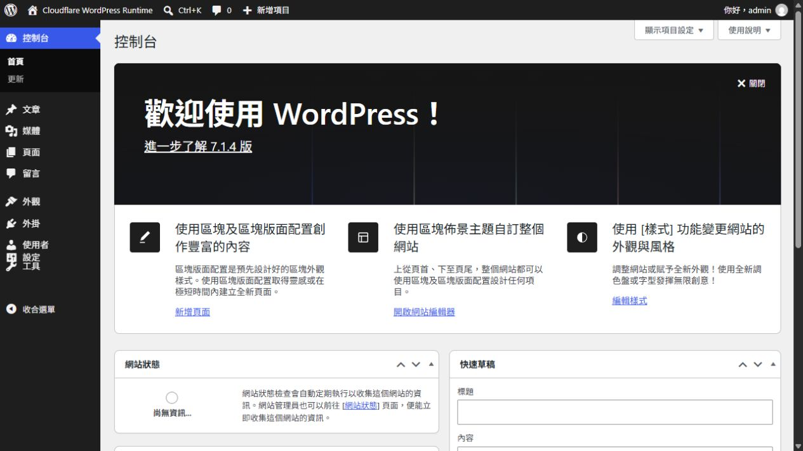

# 首次啟動與繁中初始化修正

2026-11-25（台灣時間），新的空白本機站完成原生外掛上傳、繁中初始化、停用及刪除工具、完整 workerd 重啟、網站／使用者語言讀回，以及瀏覽器登入、一般設定核對與登出。這次修正兩個可重現的問題；沒有操作 Cloudflare 或正式 Pages。

## 修正與證據

首次啟動會保存 134 個 canonical 檔案，舊版一次 Promise.all 寫入，撞到寫入帳本的 128 筆未結算上限。實際失敗停在第一個登入頁 503，尚未提交 canonical pointer；125 個部分物件、20,367 bytes／128 puts 已計入本機帳本並封存，沒有刪除或退回用量。候選改成逐一等待物件保存，不提高上限；失敗後不會留下仍在寫入的背景批次。

原始函式與候選的 5 個測試涵蓋 134 檔重現、候選最大 pending1、途中失敗、相同內容去重與未變修訂零寫入。隔離完整建置 215 輸入中僅 `src/worker.ts` 改動，214 輸入與 5 個二進位模組保持精確；77 個來源載入、typecheck／dry-run 通過。新 JS SHA256 為 `2e9819b0c9602eb937b2819196242a047877923b2d79a27ebdcd821d294074c1`，尚未部署。中央 runtime 的 82 來源與 20 設定不變。

第一次序列保存試驗完成了管理員繁中畫面，但獨立備份發現 **WPLANG 根本沒有保存**。舊初始化工具在複製語言檔前，WordPress 已快取空目錄；後續 sanitize_option 拒絕未列入可用語言的 zh_TW。使用固定版本的真實 PHP、WordPress 語言檢查及快取函式，重現「使用者 zh_TW、網站 false」；這項微型測試的選項資料庫與 hook 是替代 fixture，不當作原生保存證明。

初始化工具 1.0.1 在複製後刪除該目錄的 translation_files 快取，再檢查語言可用及 WPLANG 寫入讀回。只清除該目錄快取，其他快取保留。實作依據：[WordPress 語言檔快取](https://developer.wordpress.org/reference/classes/wp_textdomain_registry/get_language_files_from_path/)及[官方失效處理](https://developer.wordpress.org/reference/classes/wp_textdomain_registry/invalidate_mo_files_cache/)，並以本專案固定 WordPress7.1.4 原始碼核對。

## 新空白站驗證

每輪只預置三個固定 runtime／static／MDI 資產，沒有匯入既有站台資料。候選先建立英文站，再由原生 HTTP 外掛流程安裝固定 77 個語言檔（2,500,119 bytes）。每個階段均完整匯出到另一個獨立目錄並驗證雜湊。

| 本機試驗 | 實際保存 | 最終獨立備份 | 結果 |
|---|---:|---:|---|
| 原始並行啟動 | 20,367 bytes／128 puts | 未提交 pointer | 已封存，保留部分物件 |
| 序列啟動＋工具1.0.0 | 6,366,993 bytes／254 puts | LOCAL11，220物件／218檔 | 管理員繁中；網站語言缺失 |
| 序列啟動＋工具1.0.1 | 6,369,525 bytes／255 puts | LOCAL11，221物件／219檔 | 網站、使用者及匿名登入頁繁中 |

成功輪在完整 dispose 舊 workerd、確認9582／9583端口關閉及新 instance 啟動後，讀回 REST settings.language、使用者 locale 和 `_options/WPLANG.json`，均為 zh_TW。同一帳本與窗口不變，沒有重新匯入或開窗。移除工具後的77個語言檔精確，瀏覽器原生一般設定亦顯示網站語言 zh_TW，最後原生登出並確認所有測試 session 移除。

離線逐檔檢查核對英文基線至結束的全部變動：語言檔、WPLANG、管理員語言／偏好、原生 dashboard 空白草稿4、postmeta 舊格式等值搬移、原生維護排程及單調計數。原文章／頁面內容、使用者帳戶、媒體和主題精確。所有試驗已 closed／sealed／pending0，程序 terminal；Worker 外連嘗試0。這些是本機帳本，並非 Cloudflare 用量。

## 保留的限制

工具1.0.0試驗的歷史 summary pass 僅表示其較窄斷言通過；本層離線稽核明確判為網站語言未保存。該輪重啟後有兩次 `Network connection lost`，原因未證明；Chrome 控制在登入前失敗，後改用內建瀏覽器完成普通表單。首次啟動前的依賴載入失敗亦保留原 log，未建立站台。

工具1.0.1輪觀察到的 server exceptions 為0，但瀏覽器 console 未另行檢查。定時 Inspector 樣本及 PHP request 邊界觀測不是整個 isolate 的尖峰記憶體、計費 CPU 或免費環境驗收。不能把不同時間的最大值相加當總用量。首次繁中初始化現在有本機完整證據，雲端版本、視覺編輯、實體繁中輸入／手機及長期免費仍待驗收。

## 重建與操作

先依 [REBUILD](../REBUILD.md)、[lazy-core](../lazy-core/README.md)與 [canvas-typing](../canvas-typing/README.md)重建前置來源／工具。本層新增14個工具，384工具hash、930組裝檔全部核對，原916檔精確不變。組裝只安裝工具，候選修改由建置程式另存到新的完整 build。

```powershell
python install-local-tools.py --runtime <runtime-cloudflare> --apply
node --import tsx scripts/playtt-bootstrap-serial-build.mjs --local
# 在新隔離 build 接上已固定的本機依賴，執行 typecheck 及 Wrangler deploy --dry-run。
node --import tsx scripts/playtt-bootstrap-serial-build.mjs --local --check
node --import tsx --test tests/playtt-bootstrap-serial.test.mjs
node --import tsx scripts/playtt-locale-cache-php-proof.mjs --local
node --import tsx scripts/playtt-locale-complete-local.mjs --local
# browser-ready 後以原生 UI 登入、確認網站語言、登出；再封存。
node scripts/playtt-locale-complete-control.mjs finish --local
node --import tsx scripts/playtt-bootstrap-locale-offline-audit.mjs --local
```

需要既有私人 assets、lazy-core build plan、canvas-typing 終止證據與 wrapper、語言原始ZIP、1.0.0及1.0.1 initializer ZIP。本次1.0.1ZIP SHA為 `4c2d1c79522f3c279f373301aaf7ae59d020f21eb9b31edcc9bd471d463b2a81`；PHP檔SHA為 `b005ff790968b1009f8fab634f0e456b019662855d83640c0fe84dc4bae42f3d`。既有 builder 的 ZIP 時間戳不固定；重新打包要比對 entry 內容並建立新的測試計畫，不修改舊試驗的 SHA 來冒充相同輸入。

local-only 工具拒絕 --remote；新站本機窗口600秒／32MiB／512puts，僅127.0.0.1:9582／9583，外連禁止。既有 owner／build 不能覆寫或重播；失敗的部分資料與帳本保留。離線稽核不啟動 Worker、不開窗。不要提交 owner、原始日誌、備份內容、密碼或 OAuth 設定。

雲端最後核驗仍 canonical201／17pins／reader9377b040／152MB cap／餘1,067,374bytes／封存／publisher paused；本次未讀取或改動雲端。先前單次寫入授權已使用。PR4 draft、正式 Pages 與原視覺不變，完整目標保持開放。

證據：[建置](../../../docs/verification/cloudflare-bootstrap-locale-build.json)、[5個測試](../../../docs/verification/cloudflare-bootstrap-locale-tests.json)、[快取重現](../../../docs/verification/cloudflare-bootstrap-locale-cache-proof.json)、[逐檔稽核](../../../docs/verification/cloudflare-bootstrap-locale-audit.json)、[瀏覽器](../../../docs/verification/cloudflare-bootstrap-locale-browser.json)。


