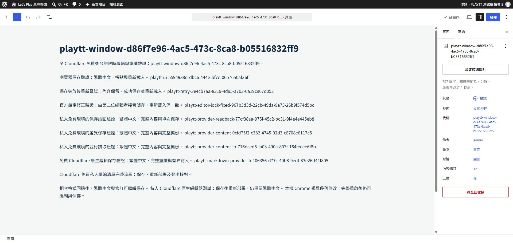

# 本機 Chrome 視覺編輯與冷重啟驗證

2026-11-24，從已獨立驗證的雲端 canonical201 備份建立兩個隔離本機副本。Chrome 原生視覺編輯已完成繁中段落保存、完整 workerd 重啟、新分頁畫布與原生程式碼欄全文讀回、12 筆修訂及登出。本輪未操作 Cloudflare，也未修改 WordPress runtime；正式 Pages 與原視覺維持現況。

## 結果與保留的失敗

第二輪先點選末段，按 End，再用鍵盤輸入。原生「儲存草稿」正常啟用，唯一 pages/193 POST 回應200、全文 SHA 精確。重啟前關閉分頁，完整 dispose 舊 workerd、確認兩個端口關閉、建立新 instance；資料、帳本與同一窗口精確，沒有重新匯入或重新開窗。重啟後原生畫布與程式碼欄全文一致，原生登出畫面及 session 移除都已核對。

本機限600秒／1,881,041bytes／96puts，實際648,188bytes／39puts，LOCAL201→214。304物件／298檔獨立備份與完整快照還原精確；新增revision210，所有原修訂、其他文章、使用者、媒體及主題精確。僅自有草稿、edit-lock、user2編輯偏好與單調計數改動。最後closed／sealed／pending0、程序exit0。

第一輪保留為未通過：跨iframe的fill先逾時，後續paste／輸入可見，但手動保存一直停用。五次原生autosave200把文字（含最後測試字元x）放入自有autosave210，主草稿完全未變。LOCAL226已封存及dispose；獨立備份精確核對其autosave、footnotes、edit-lock、偏好與本機session，其他資料未變。該本機session仍保留在關閉的測試副本中。未執行完整重啟或登出，所以不能算成功。新一輪鍵盤輸入通過並未證明第一輪異常的精確原因。

兩輪server exception均0，但瀏覽器不是零警告：成功輪保留兩次global-styles iframe警告及登出頁一次ViewTransition InvalidStateError；登出畫面與資料移除仍已核驗。第一次截圖／後續部分瀏覽器操作逾時與不支援的inputValue／CDP Input方法未計作驗證通過。

## 空白畫布的環境差異

重新執行既有的純HTML fixture，完全不含WordPress或Cloudflare。Chrome的普通URL、srcdoc、blob iframe均載入並可插入內容；內建瀏覽器只有blob iframe無load事件、內容空白，並有兩個MutationObserver錯誤（fixture未呼叫該API）。這支持內建瀏覽器的blob框架限制；並未證明其內部成因，也不是所有瀏覽器驗收。

兩個成功fixture分頁已關閉、server已停止。一個先前localhost連線失敗產生的內建瀏覽器data:錯誤分頁，因工具URL政策無法關閉，保留為清理限制；該頁不連接仍在運行的測試服務。

## 重建與操作

先依[REBUILD.md](../REBUILD.md)及[native-approved](../native-approved/README.md)重建前置工具，再安裝本層8個local-only工具；不新增runtime或設定修改。370個工具hash與916個組裝檔案核對，原908檔保持不變。

```powershell
python install-local-tools.py --runtime <runtime-cloudflare> --apply
node --import tsx scripts/playtt-canvas-typing-local.mjs --local
```

需要原本私人工作區的已核驗canonical201備份、native-approved owners與final結果、native-next fixture、既有測試帳戶、固定資產及lazy-core建置計畫。不要把owner、備份、密碼、原始log或OAuth檔放Git。六個固定模組及82中央來源均先驗證；JS為19f8bc17966c12b82518961dc550a95672a0c859b2017577bb82fc04c44b0b0d。本輪未重新建置核心。

只監聽127.0.0.1:9580／9581，Worker外連禁止。先證明前一個程序terminal，再開第二個；不得停止不明程序。每輪owner存在即拒絕，保留guard與舊證據。這些既有attempt不可重播。新測試需在新工作副本建立自己的owners。

透過Browser技能實際登入、點選段落及鍵盤輸入，按原生保存。`playtt-canvas-typing-local-control.mjs saved --local`核對唯一保存receipt與全文；關閉分頁後`restart`完整重啟，再以新分頁核對畫布／原生程式碼欄，`cold`核對存檔；原生登出後`finish`封存。控制命令逾時要查同一command，不能重送。不要用API保存或強制啟用按鈕代替UI驗收。

第一輪server／observer／control及只讀R2 recovery工具一併保留。第二輪在終端斷言前先輸出terminal備份，便於保留失敗資料。`playtt-canvas-typing-offline-audit.mjs --local`重新核對兩份完整資料、逐row允許變化、執行來源hash、原生browser證據及成功輪materialized備份；它不開server、不讀雲端。

原始harness沿用舊版報告的build/adoption/cloud-flags標籤，不能當作本輪變更證據；[離線稽核](../../../docs/verification/cloudflare-canvas-typing-audit.json)中的固定模組hash及實際本機結果才是本輪依據。

## 驗收界線

這次是本機Chrome視覺編輯成功，尚未取得雲端視覺編輯、實體鍵盤／繁中IME、手機、首次繁中初始化及長期Free／provider尖峰記憶體與CPU驗收。局部Inspector樣本不是Cloudflare用量。正式Pages、DNS、方案及雲端寫入帳本沒有本輪變更；雲端最後核驗仍201／17pins／9377b040 reader／152MB cap／餘1,067,374bytes／封存。單次核准雲端窗口已使用，不能由本機成功延伸成新雲端寫入授權。PR4保持draft。

證據：[純iframe比較](../../../docs/verification/cloudflare-canvas-typing-fixture.json)、[成功UI](../../../docs/verification/cloudflare-canvas-typing-browser.json)、[失敗UI](../../../docs/verification/cloudflare-canvas-typing-failed-browser.json)、[逐檔資料稽核](../../../docs/verification/cloudflare-canvas-typing-audit.json)。


