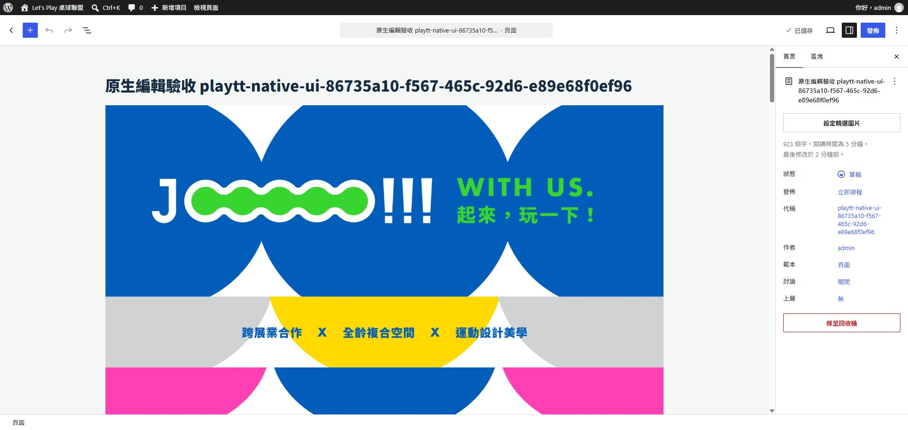

# 原附件修復、網址遷移與原生編輯驗收

私人重建站的圖片檔原本存在，但 WordPress 的附件路徑與圖片 metadata 已在舊匯出中遺失。首頁另有內嵌圖片網址仍指向舊測試站。這輪補回可由原檔證實的附件資料、遷移現有內容，並完成繁中原生區塊編輯器的儲存與重開驗收。正式 `playtt.tw` Pages、原視覺、路由及後台來源未切換；沒有新增付費方案。

目標是私人 `playtt-wp-free-rebuild-audit`／R2 `playtt-wordpress-rebuild-audit`。Worker 程式仍為 `643a81da-b010-4748-95e2-f22732d9e5e7`，本輪沒有部署新程式。來源 daily Worker 亦未改動，兩邊 publisher 都是 paused。PR #4 維持 draft，整體目標 active。

## 15 個附件：14 個品牌原檔與 1 個舊測試檔

先前文件把15個附件統稱為品牌圖片不精確：14個是已提交主題中的 WebP，另1個是舊1×1 PNG探針。先從已驗證備份 `edf7bf71-b84e-444e-a6d9-1cce10366841` 讀取附件、上傳檔與完整 postmeta，逐一核對原檔 SHA-256；14個品牌檔另與主題素材比對。

在一次性的固定 WordPress7.1.4／PHP8.3.36／SQLite環境，以原生 `wp_generate_attachment_metadata()` 生成尺寸與metadata，沿用品牌原圖不產生縮圖的既有政策。只補15筆 `_wp_attached_file`、15筆 `_wp_attachment_metadata`、14筆 `_lets_play_asset`，合計44筆；不猜測歷史替代文字、標題或未知欄位。原有4筆完全保留，新增meta_id21–64，高水位20→64。

完整還原包只有 `_tables/postmeta.json` 與 `_runtime/playtt-auto-increment.json` 兩檔變動。四個不可變物件上傳私人R2後全部下載核對SHA；在fence內核對基準version85／pointer，採用新pointer並單調推進至86。這不是 reset 或覆蓋其他站點。原生媒體REST再核對15個附件的ID、標題、代稱、GUID不變，尺寸／檔案網址正確，15個圖片位元組與原檔相同。

修復後完整備份證明48筆metadata逐位元一致。第一個本機比對曾錯把登入後 `wp_options` 高水位290→293視為不允許的變動；原始失敗與修正診斷保留，後續只允許登入造成的options高水位和usermeta session差異，不放寬附件欄位的相等檢查。

## 現有內容與原生瀏覽器驗收

`postmeta/playtt-origin-migration.mjs` 規劃34個可編輯項目，只改5個content欄位的30處精確舊origin：導覽61的5處、首頁24的14處、教練頁27的8處、footer的1處、header的2處。修改前完整備份、逐項衝突檢查及原生REST讀回均通過。GUID、外部LINE／地圖連結、其他文字、樣式、設定及媒體metadata保持一致；清理後新登入再讀全部34項仍等於預期hash `7403bbe5e84a5c03cad186c700ce8dceec6e4abaa31f26f501072aa740113473`。

真實瀏覽器中，首頁副本草稿136的七張可見圖片全部載入，原站主視覺正常顯示。只將一個段落加上「原生編輯驗收：」，按原生「儲存草稿」，回到清單後重開，文字與七張圖片保留。後端獨立讀回確認原首頁完全不變。原生儲存另外重排區塊註解邊界換行、去掉4個class尾端空白、略去6個預設h2層級屬性、將一個固定段落的 `&` 編碼成 `&amp;`。兩次嚴格字串比對失敗都保留本機紀錄，逐項審查後只接受這些明確格式變換，沒有泛化忽略HTML或文字差異。

身分、標題、代稱、狀態及保存內容核對後，僅清除自有草稿136與其修訂；REST讀回404。前台桌機首頁的9個可見圖片元素在捲動後全部載入；首屏時教練圖尚未載入是其 `loading=lazy` 行為，原始與捲動後證據都保留。這輪未重做手機或所有後台流程驗收。

## 最後備份與觀測界線

最後私人站version133／revision `c79f3f55-93b6-4bbf-9ec6-3fb0462d5cfc`，完整備份297個索引、2,292,804壓縮bytes，SHA `3ad8e97c397868c8a7e53720f7eb41f763d0fa0d7c8f93edeb72a24840cc1812`。解碼後確認27個遷移後既有Markdown、15個上傳檔及wp-content未被測試改動；48筆metadata完整且編號不變，草稿／修訂／metadata136均已移除，自增高水位保留。來源仍version174；兩站一致、無fence、paused，未具probe身分的後台／REST／媒體404。這是完整備份驗證，不冒充又一次空站還原。

754個有限觀測事件中742 ok、12 canceled，沒有記錄到例外，但有1個未完成trace及1次 `admin-ajax POST / request-body-unavailable`，發生於PHP執行前（bodyUsed=true、signalAborted=false）。取消事件可能來自同一HTTP請求的不同層，不能把12事件算成12次使用者操作。兩個post-editor GET取消事件與瀏覽器10秒導覽逾時時間接近；因果尚未證明。後來從原生清單進入成功，仍不能據此忽略延遲與取消問題。

最大觀測WASM heap80,084,992bytes不是整個isolate用量，也不是長期穩定保證。觀測已停止，作業系統檢查沒有殘留tail程序。來源14段patch／60檔重新組裝一致，新增／更新6個工具逐位元一致且語法檢查通過；因runtime程式沒有再改，未重跑既有編譯／完整安裝／部署。

## 重現與下一步

工具是本次有界遷移的稽核記錄，固定基準、目標與私人狀態，拒絕覆寫已存在計畫。**不要刪除私人狀態檔重跑 prepare/apply/cleanup。** 完整備份、含session資料的原始表與私人計畫不進Git；本目錄只有工具、公開摘要及經檢查的畫面。`rebuild-candidate.py` 已納入本目錄工具。

執行順序為本機prepare → 遠端upload／apply／verify → after-media-repair備份 → origin plan／before-origin備份／apply／verify → after-origin備份 → native-ui prepare／真實UI修改與重開／verify／cleanup → origin verify → after-native-ui備份 → final-check。Wrangler使用專案的 `XDG_CONFIG_HOME`；沒有登入或原始私人計畫時不可假裝可重播。

仍有18個歷史修訂的28處內容網址指向舊測試站。這輪保留修訂原文與GUID；若回復那些修訂，可能重新帶入舊網址。下一步先診斷實際觀測到的request-body-unavailable／取消與互動延遲，再處理修訂回復後的網址、其他原生流程、手機與交接驗收、持續免費用量。尚未獲得或執行正式後台切換。

主證據：[總表](../../../docs/verification/cloudflare-media-repair-summary.json)、`playtt-media-repair-final.json`、`playtt-media-repair-observation.json`、`playtt-native-ui-verification.json`、`playtt-native-ui-format-differences.json` 與 `visual/`。
